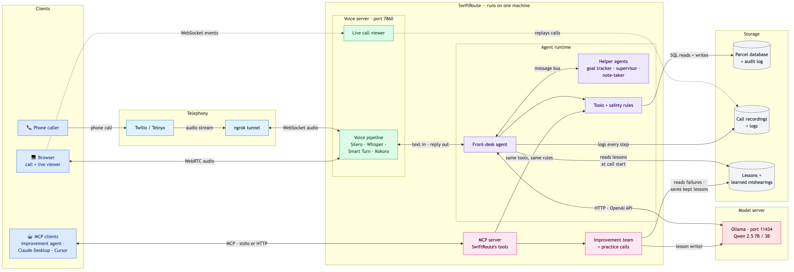

# SwiftRoute

A voice assistant for a parcel courier, built entirely on open-source models that run locally: Whisper for speech-to-text, Qwen 2.5 on Ollama, and Kokoro for speech. It includes a multi-agent call team, an MCP server, and an improvement loop that learns from each call.

The project is in [`swiftroute/`](swiftroute/). Start with its [README](swiftroute/README.md) and the [architecture overview](swiftroute/docs/architecture.md).

