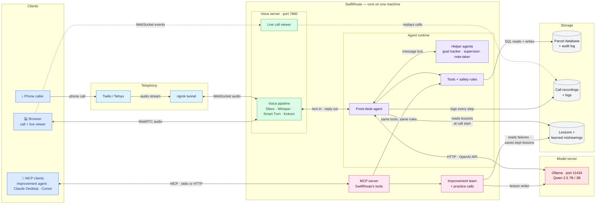
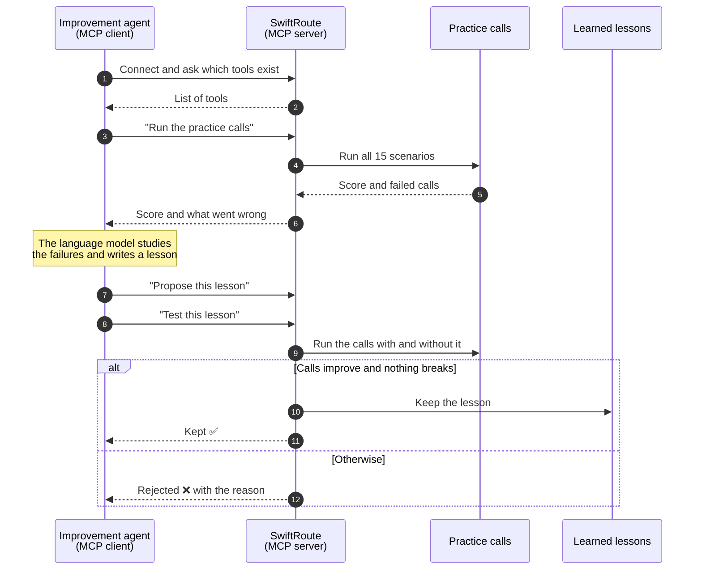

# SwiftRoute architecture

SwiftRoute is a phone assistant for a parcel courier. Callers can ask where their parcel is, reschedule a delivery, change the address, hold it at a depot, or report it damaged or missing. Everything runs on one machine, except the phone network.

## Architecture overview

### Components

| Component | What it is | Talks to |
|---|---|---|
| **Clients** | People calling by phone or from a browser, plus AI tools that connect over MCP | Telephony, voice server, MCP server |
| **Telephony** | Twilio or Telnyx carry phone calls; ngrok gives the local machine a public address | Voice server, over a WebSocket audio stream |
| **Voice server** (port 7860) | The voice pipeline: **Silero** detects speech, **Whisper** turns it into text, **Smart Turn** decides when the caller has finished, **Kokoro** speaks the reply. It also serves the live call viewer. | Callers (audio), front-desk agent (text) |
| **Front-desk agent** | Runs the conversation. Handles tracking numbers and postal codes in plain code, and asks the AI model for everything else. | Voice server, helper agents, Ollama, tools, storage |
| **Helper agents** | Goal tracker, supervisor and note-taker. They watch each turn and coach the front-desk agent over a message bus. | Front-desk agent only |
| **Tools + safety rules** | Every action (status, reschedule, change address, hold, claim, transfer) goes through here. The rules approve or refuse it, and the AI can't skip them. | Parcel database |
| **Ollama** (port 11434) | Runs the **Qwen 2.5** language model, 7B or 3B. Spoken to over HTTP with the OpenAI API format, so vLLM or llama.cpp also work. | Front-desk agent, improvement team |
| **MCP server** | Exposes SwiftRoute's tools to outside AI clients. Call tools use the same safety rules as a phone call. | MCP clients, tools, improvement team |
| **Improvement team** | Between calls, it reads failed calls, writes short lessons, and keeps one only if the practice calls improve. | Ollama (to write lessons), storage |
| **Storage** | The parcel database with an audit log of every action; call recordings and logs; kept lessons and learned mishearings | — |

### How a call moves through it

1. The caller's audio reaches the voice server, by WebRTC from a browser or by WebSocket from Twilio or Telnyx.
2. Whisper turns the speech into text, and the text goes to the front-desk agent.
3. The agent asks Ollama what to say. If it wants to change something, the tools and safety rules check it first, then update the database.
4. Kokoro speaks the reply back down the same connection.
5. Every step is logged. The live call viewer shows it as it happens and can replay it later.
6. Between calls, the improvement team learns from those logs. Kept lessons are loaded at the start of the next call.

## How the MCP client and server talk

MCP (Model Context Protocol) is a standard way for an AI agent to use another program's tools.

- **The server** is SwiftRoute. It offers tools such as "look up a parcel", "run the practice calls", "propose a lesson" and "test a lesson".
- **The client** is the improvement agent. It starts the server, asks which tools exist, then calls them one at a time.

The client can suggest lessons, but only the server decides whether a lesson is kept.

Other MCP clients, such as Claude Desktop or Cursor, can connect to the same server the same way and use its parcel tools under the same safety rules. Because an MCP client could claim to be anyone's phone number, these clients can only check a parcel's status. They can't change a delivery.

Image copies of both diagrams, for viewers that don't show Mermaid: [architecture.png](architecture.png) and [mcp-flow.png](mcp-flow.png).
